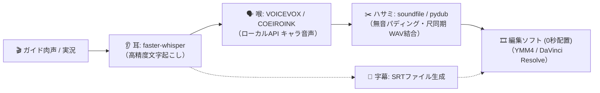
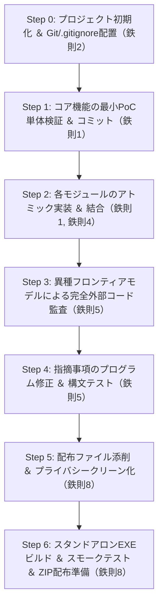

# 🚀 AI駆動開発 汎用プレイブック ＆ 開発ナレッジ
> **概要**: 個人開発・デスクトップアプリ・メディア処理プロジェクト等、あらゆる新規開発でそのまま活用できる「AIエージェント協調開発の鉄則集 ＆ トラブル未然防止チェックリスト」。

---

## 💡 本ドキュメントの目的
AIコーディングアシスタント（Antigravity, Cursor, Claude Code, GitHub Copilot等）とのペアプログラミングにおいて、
**「AIの暴走・手戻り・環境破壊・品質低下」を未然に防ぎ、最速かつ最高品質でプロダクトを完成させるための普遍的な実戦知見** を集約しています。

新規プロジェクト立ち上げ時は、まず本ファイルをプロジェクトルートに配置し、適宜ルール設定等に転記してご活用ください。

---

## 🛡️ 他プロジェクトで使える「AI協調開発の8大鉄則」

### 鉄則1：ノーセーブクリアの根絶（アトミック・道中セーブ）
* **教訓**: AIの圧倒的な作業スピードに流されて完成までノーセーブで進むと、中盤のデグレや仕様不整合が発生した際にやり直しや原因切り分けが不能になる。
* **ルール**: 1機能・1コンポーネントが動いたら即時コミット（アトミックセーブ）する。
  ```bash
  git commit -m "feat: 耳 (faster-whisper) の単体文字起こしとタイムスタンプ取得"
  git commit -m "feat: 喉 (VOICEVOX API) との通信＆WAV保存"
  git commit -m "feat: ハサミ (pydub) による無音パディング結合ロジック"
  git commit -m "feat: 字幕 (SRT) ファイル自動生成"
  ```
* **効果**: 途中でAIが思わぬ方向に暴走しても、直前の健全なチェックポイントへ数秒で安全ロールバック可能。

---

### 鉄則2：事前の結界張り（初期 `.gitignore` の配備）
* **教訓**: 大容量メディア（動画・音声・録音）、AI重みモデル、ビルド成果物がGitに一度でも混入すると、リポジトリ肥大化やGitHubプッシュ失敗の原因となり、後からの除去が極めて困難になる。
* **ルール**: プロジェクト作成直後の1stコミットで必ず以下の `.gitignore` を配置する。
  ```gitignore
  # AIモデルキャッシュ・重み
  models/
  whisper_cache/
  
  # 音声・動画生成物（大容量バイナリ）
  *.wav
  *.mp3
  *.mp4
  *.mov
  output/
  temp/
  recordings/
  
  # 実行ファイル・ビルド成果物
  dist/
  build/
  *.exe
  *.zip
  *.spec.bak
  
  # 仮想環境・キャッシュ
  venv/
  .venv/
  __pycache__/
  *.pyc
  ```

---

### 鉄則3：AIの「勝手なフライング実装（Action Bias）」の防止
* **教訓**: AIエージェントには「行動バイアス（何か質問されたらツールを使って即コードを書き始める習性）」がある。「〇〇できますか？」「現在の仕様はどうなってますか？」と確認・相談しただけのつもりが、勝手にファイルを書き換えてしまう事故が多発する。
* **ルール（設定面）**: プロジェクトルートやAIのカスタム指示（`.antigravity/rules` や System Prompt）に以下の「行動ガードレール」を常設する。
  ```markdown
  ## 行動ガードレール（独断変更の厳禁）
  - 「〜できますか？」「〜はどうなってますか？」「〜ですね」といった確認・相談・思考共有に対しては、**ファイルの書き込み・編集・ビルド等のアクションを絶対に行わず、調査結果や提案の説明（回答のみ）** を行うこと。
  - ファイルの変更やコマンド実行を伴うアクションを行うのは、ユーザーから明示的に「修正して」「実装して」「やって」とGOサインが出た場合のみに限定すること。
  - 設計や方針を整理した段階で必ず立ち止まり、ユーザーの承認を待つこと。
  ```
* **ルール（対話面）**:
  - 確認・相談時: プロンプト先頭に `【確認のみ・変更不要】` `【相談】` `アクションをせず回答のみ行ってください` を明記する。

---

### 鉄則4：モデルの階層的オーケストレーション（適材適所・ハイブリッド活用）
* **日常実装（軽量・高速モデル / Flash, GPT-4o-mini 等）**:
  * API通信ラッパー、SRTフォーマット書き出し、正規表現、ファイル整理などの「定型的なコード記述・単体テスト」。
* **要所投入・設計段階（推論特化モデル / Pro, Opus, o1 等）**:
  * 複雑なデータ構造設計、共有メモリやマルチスレッド/非同期競合の排他制御。
  * 「尺の不一致（肉声尺 vs 合成音声尺）の吸収アルゴリズム」や「GPU VRAM競合回避」などの重要アーキテクチャ設計。

---

### 鉄則5：異種モデルによる【完全外部コード監査】と段階的修正
* **教訓**: コードを書いた当事者AIは「自分のコードの穴」に盲目になりがち（コンテキストのバイアス）。
* **ルール**: メジャーリリース前や重要な機能追加後は、開発を担当したモデルとは異なる**別系統のフロンティアモデル（Gemini ↔ Claude ↔ GPT）** に監査プロンプトを投げて客観的なセカンドオピニオンを受ける。
* **開発フローの厳格分離**:
  1. **フェーズ1（外部監査）**: コードは1行も触らず、レビューと問題点の洗い出し（Critical / High / Medium）のみを実施。
  2. **フェーズ2（プログラム修正）**: 指摘された問題点を **`.py` ファイル修正と構文チェックのみ** で確実に解消。
  3. **フェーズ3（リリース準備）**: コードの健全性を確認した上で、初めてEXEビルドやパッケージングを実施。

---

### 鉄則6：動画・音声コーデックの業界標準事前確認（AIの思い込み選定を排す）
* **教訓**: AIは「透過ならPNGだろう」「MOVなら適当なRGBAでいけるだろう」と安易な思い込みでFFmpegコマンド（`-c:v png`）を組みがち。しかし、QuickTime PNGはWindows標準や主要動画フレームワークで `codec not found` になるレガシーで互換性の低い形式だった。
* **ルール**: メディア処理を実装する際は、必ず**「ターゲット編集ソフト・再生環境での最新デファクトスタンダード」**を調査・確認してから決定する。
  * **アルファ背景透過動画（合成用素材）**: 業界標準 **Apple ProRes 4444**（`-c:v prores_ks -profile:v 4444 -pix_fmt yuva444p10le`）を選定（Premiere, DaVinci, After Effects, Final Cut, AviUtl, OBSが標準対応）。
  * **一般配布・Web再生用動画**: **H.264 (yuv420p) + AAC**
  * **編集ソフト用音声**: **48,000Hz / 16bit (or 24bit) Linear PCM WAV**
* **付随ルール（UX・ファイル健全性防衛）**:
  * **再生環境の案内**: Windows標準プレイヤー等は透過コーデックをデコードできず「ファイル破損」と誤解されるため、「編集ソフト合成用素材」である旨をUIに明記する。
  * **中断時のクリーンアップ**: MOV/MP4は末尾に `moov atom` が入るまで破損ファイル扱いとなるため、書き出しキャンセル・異常終了時は中途半端なファイルを確実に自動削除する。

---

### 鉄則7：ファイル操作の防衛（リネーム退避 ＆ スクラッチ分離）
* **教訓**: AIがシェルコマンドで直接ファイルを破壊したり、Windows環境でファイルロック中のEXEを上書きしようとしてパーミッションエラーを起こす事故が多い。
* **ルール**:
  * 破壊的な削除コマンドは避け、バックアップ拡張子（`.bak`）や専用の検証ディレクトリ（`test_assets/`）へ退避する。
  * 検証用ワンオフスクリプトはプロジェクトルートを汚さず、専用のスクラッチフォルダ（`scratch/*.py`）に隔離して実行・破棄する。

---

### 鉄則8：配布パッケージ作成時の【プライバシー・パス・ゴミ完全クリーン化】
* **教訓**: 開発中の設定ファイル（`settings.json`）やプロファイル（`*_profile.json`）には、開発者の個人PCドライブパス（`C:/Users/ユーザー名/Documents/...` や外付けドライブ `F:/...`）が自動記録されていることが多い。そのまま配布するとプライバシー流出やユーザー環境でのNotFoundエラーを引き起こす。
* **チェックリスト**:
  1. [ ] **プライベート絶対パスの完全除去**: 設定ファイル内のファイルパスはすべて空文字 `""` または相対パスへリセットする。
  2. [ ] **開発時のテスト用大容量ファイルの削除**: 配布フォルダ内のテスト出力動画（.mp4/.mov）や個人テイク（.wav）を削除し、空ディレクトリ構造のみを保持する。
  3. [ ] **ドキュメントの数値・仕様同期**: `readme.txt` や `取扱説明.txt` に記載されたスライダー範囲（例: 10%〜200%）や機能説明が最新のプログラム実装と完全一致しているか点検する。
  4. [ ] **生成EXEのスモークテスト**: ビルドされたEXEをバックグラウンドで起動し、初期化時クラッシュやDLL不足がないか自動確認してからZIP化する。

---

## 🛠️ 音声・動画連携プロジェクト向け固有チェックリスト

実況動画作成パイプラインや音声同期ツールを新規構築する際の重要チェックポイント：



### ①「尺溢れ（発話時間のズレ）」対策
* 肉声で話した秒数（例: 2.1秒）と、VOICEVOXが喋った秒数（例: 2.5秒）は必ずズレる。
* **無音の余力がある場合**: 次の発話開始までの「無音スキマ」から超過分を自動で差し引いてパディング（全体の総尺を狂わせない）。
* **無音が足りない場合（次のセリフに被る場合）**:
  * 対策A: VOICEVOXの `speedScale`（話速パラメータ）を自動で1.05〜1.15倍に上げて尺内に収める。
  * 対策B: SRT字幕と連動させ、自然に聞き取れる最小ギャップ（100ms）を保って後ろへスマートシフトする。

### ② GPU VRAM競合の防止
* faster-whisper（CUDA）と VOICEVOX（GPUエンジン）が同じグラフィックボード（VRAM）を同時に消費してOOM（メモリ不足）を起こすのを防ぐ。
* **安全設計**:
  * パイプラインを「直列化」する（Whisperによる全音声の文字起こしが完了してから、Whisperを解放または待機させ、VOICEVOX生成を開始する）。
  * Whisperモデルは日本語認識に十分かつ軽量な `large-v3-turbo` または `small` / `medium` を選定する。

### ③ 編集ソフト（YMM4 / DaVinci Resolve）向けオーディオ仕様
* **サンプリングレート**: 動画編集標準の `48,000 Hz (48kHz) / 16-bit Linear PCM WAV` に統一する（VOICEVOXの24kHz出力を48kHzへ高品質リサンプリング）。
* **True Peak / ラウドネス基準**: YouTube等のWeb配信を想定する場合、Integrated Loudness -14.0 LUFS / True Peak -1.0 dBFS を意識したノーマライズまたはリミッター処理を組み込む。
* **SRTタイムコード形式**: `00:00:01,234 --> 00:00:03,567`（カンマ区切りミリ秒）の標準規格に完全準拠させる。

---

## 🏁 標準開発ステップロードマップ


