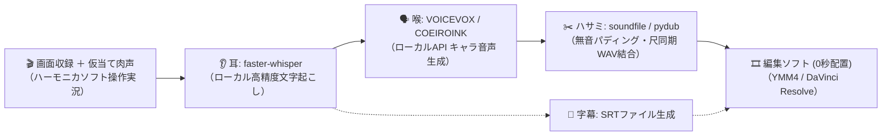
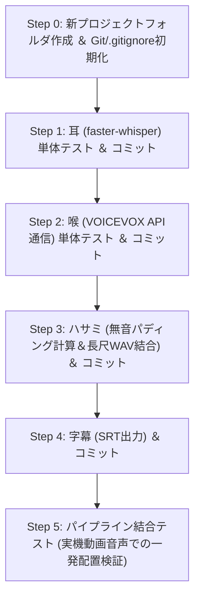

# 🚀 AI駆動開発プレイブック ＆ 新パイプライン構築チェックリスト
> **対象プロジェクト**: ハーモニカ練習ソフト紹介動画用「肉声実況 ➔ VOICEVOX自動同期・字幕パイプライン」

---

## 💡 プロジェクトの目的と全体像



* **課題**: 操作しながらの実況説明で地声をそのまま使うのはハードルが高い。
* **解決策**: 操作しながら話した「ガイド肉声」から、**ミリ秒精度の発話位置** を抽出し、**キャラクター合成音声の長尺1本WAV ＋ SRT字幕** を全自動生成。動画編集ソフトのタイムライン先頭（00:00）に置くだけで完全同期させる。

---

## 🛡️ 前作（ハーモニカv3.0）から得た「開発の4大鉄則」

### 鉄則1：ノーセーブクリアの根絶（アトミック・道中セーブ）
* **教訓**: AIのスピードに流されて完成までノーセーブで進むと、途中のやり直しや切り分けが不能になる。
* **ルール**: 1コンポーネントが動いたら即セーブ（コミット）。
  1. `feat: 耳 (faster-whisper) の単体文字起こしとタイムスタンプ取得`
  2. `feat: 喉 (VOICEVOX API) との通信＆WAV保存`
  3. `feat: ハサミ (pydub) による無音パディング結合ロジック`
  4. `feat: 字幕 (SRT) ファイル自動生成`
  5. `feat: 全体パイプラインの一括実行スクリプト`

### 鉄則2：事前の結界張り（初期 `.gitignore` の配備）
* **教訓**: 大容量ファイル（音声、AIモデル）がGitに混入すると後からの除去が極めて困難になる。
* **必須除外リスト**:
  ```gitignore
  # AIモデルキャッシュ・重み
  models/
  whisper_cache/
  
  # 音声生成物（大容量メディア）
  *.wav
  *.mp3
  output/
  temp/
  recordings/
  
  # 仮想環境・キャッシュ
  venv/
  .venv/
  __pycache__/
  ```

### 鉄則3：モデルの階層的オーケストレーション（適材適所）
* **日常実装（軽量・俊足モデル）**:
  * Whisper呼び出し、VOICEVOX REST APIリクエスト、SRTフォーマット書き出し、ファイル整理などの「定型・コード記述」。
* **要所投入（Gemini 4.0等 上位推論モデル）**:
  * **「尺の不一致（肉声尺 vs 合成音声尺）の吸収アルゴリズム」** の設計。
  * **「GPU VRAM競合（WhisperとVOICEVOXのメモリ衝突）」** の回避設計。
  * 結合テスト時の例外・タイムスタンプズレ検証。

### 鉄則4：ファイル操作の防衛（リネーム退避ルール）
* 自動化・テスト実行中のユーザー承認ブロックを防ぐため、`rm` や `os.remove` は使わず、テストファイル生成は専用 `test_assets/` または `.bak` リネームで安全運用する。

---

## 🔍 新パイプライン固有の技術チェックリスト（先回り防衛）

### ①「尺溢れ（発話時間のズレ）」対策
> [!IMPORTANT]
> 肉声で話した秒数（例: 2.1秒）と、VOICEVOXが喋った秒数（例: 2.5秒）は必ずズレます。

* **無音の余力がある場合**: 次の発話開始までの「無音スキマ」から超過分を自動で差し引いてパディング（全体の総尺を狂わせない）。
* **無音が足りない場合（次のセリフに被る場合）**:
  * 対策A: VOICEVOXの `speedScale`（話速パラメータ）を自動で1.05〜1.15倍に上げて尺内に収める。
  * 対策B: SRT字幕と連動させ、自然に聞き取れる最小ギャップ（100ms）を保って後ろへスマートシフトする。

### ② GPU VRAM競合の防止
* **状況**: faster-whisper（CUDA）と VOICEVOX（GPUエンジン）が同じグラフィックボード（VRAM）を同時に消費する。
* **安全設計**:
  * パイプラインを「直列化」する（Whisperによる全音声の文字起こしが完了してから、Whisperを解放または待機させ、VOICEVOX生成を開始する）。
  * Whisperモデルは日本語認識に十分かつ軽量な `large-v3-turbo` または `small` / `medium` を選定する。

### ③ 編集ソフト（YMM4 / DaVinci Resolve）向けオーディオ仕様
* **サンプリングレート**: 動画編集標準の `48,000 Hz (48kHz) / 16-bit Stereo (or Mono) PCM WAV` に統一する（VOICEVOXの24kHz出力を48kHzへ高品質リサンプリング）。
* **SRTタイムコード形式**: `00:00:01,234 --> 00:00:03,567`（カンマ区切りミリ秒）の標準規格に完全準拠させる。

---

## 🏁 開発ステップロードマップ



